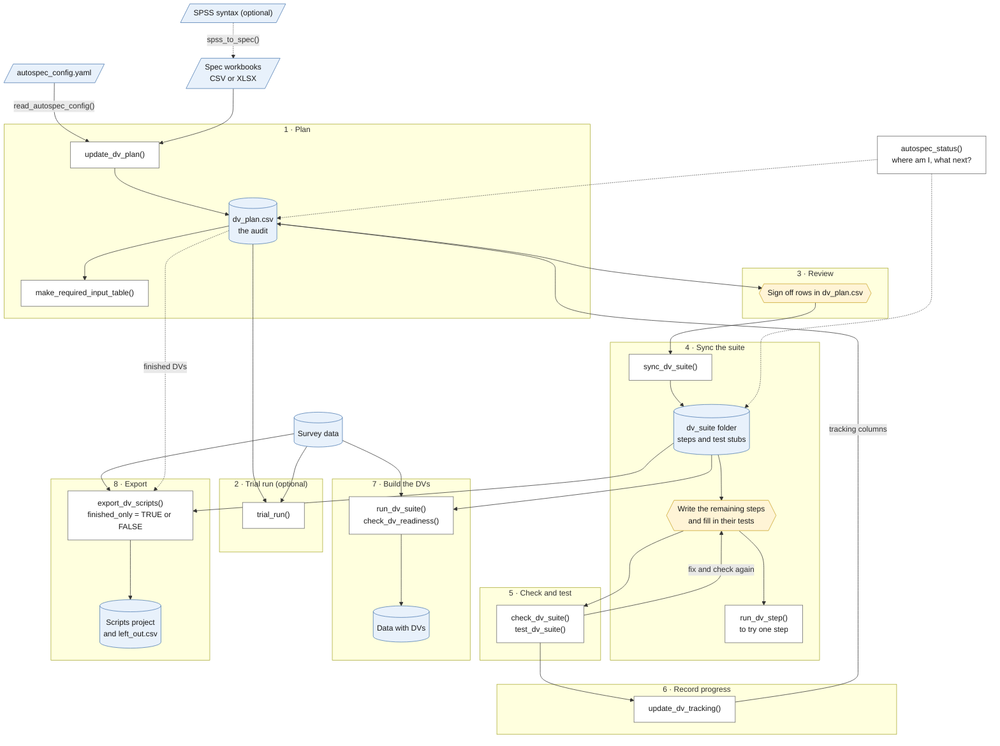

# autospec

A derived variable (DV) is a value calculated from existing data. `autospec`
reads pseudo-code specifications and writes the R code that builds them: the
**DV suite**. You can review, test, edit and run that suite.

## Set up (once, and after pulling new code)

1. Open `autospec.Rproj` in RStudio.
2. Restart R: **Session > Restart R**.
3. Run `source("setup_autospec.R")`.

The script says what it is doing at each step. If a step fails, it tells you
what to do; fix that and run it again.

## Settings for the round

`autospec_config.yaml` holds the round number and every file path: the spec
folder, the data file, and where outputs and the DV suite go. Anywhere it says
`{round}`, the round number is filled in. For a new round, change `round` and
`data_file`, and check the rest. `read_autospec_config()` reports what it finds.

Variable names are matched ignoring case, so the spec and the data can spell
them differently. The suite spells every name the way the data does; new DVs
follow the data's style unless `name_case` says otherwise.

## From specs to DVs

Work through `run_pipeline.Rmd` to draft the plan, review and sign it off, then
continue with `run_pipeline_after_review.Rmd`. Every chunk is safe to run
again. [HOW_TO_RUN.md](HOW_TO_RUN.md) walks through the workflow, including
settling duplicate DVs, writing tests and rerunning after specs change. The
main steps are also in RStudio's **Addins** menu under *autospec*.

When unsure what to do next, run `autospec_status(config)`: it shows each
topic's progress and names the next step.

### How it fits together

Blue boxes are files, yellow boxes are work done by a person, and white boxes
are the functions you call. `autospec_status()` can be run at any point.



When the specs change, go back to stage 1: sign-offs on unchanged rows are
kept. Stages 4 to 6 repeat until every DV is written and its test passes.

### Stages and functions

| Stage | Main functions | Reads → writes | You |
|---|---|---|---|
| 1. Plan | `update_dv_plan()`, which runs `make_catalogue()` and `build_dv_plan()`; `make_required_input_table()` for the input audit | Specs → `dv_plan.csv`, `QA_derivation_catalogue.csv`, `QA_duplicate_dvs.csv`, `QA_spec_issues.csv` | Settle DVs defined twice (`QA_duplicate_dvs.csv`, or `sheet_priority` in the config). Send `QA_spec_issues.csv` to the spec owner |
| 2. Trial run (optional, any time) | `trial_run()` | Plan and data → a throwaway suite and `QA_dv_suite_trial_report.csv` | Look at the output; nothing needs signing off |
| 3. Review | none | `dv_plan.csv` | Check each row and sign it off: set `status` to `reviewed` and fill in `reviewed_by` and `reviewed_on` |
| 4. Sync the suite | `sync_dv_suite()` (or `write_dv_suite()` for a new suite in one go); `run_dv_step()` to try one step | Plan → `dv_suite/` steps and test stubs | After each batch of sign-offs. Write the steps still at `derive = NULL`, and fill in their tests |
| 5. Check and test | `check_dv_suite()`, `test_dv_suite()` | Suite → a report of problems and test results | Fix anything reported |
| 6. Record progress | `update_dv_tracking()` | Suite and its tests → the tracking columns in `dv_plan.csv` (`DV Written`, `Unit Test Stub`, `Unit Test Populated`, `Unit Test Passed`) | Run after testing; `autospec_status()` then counts the DVs written and passing |
| 7. Build the DVs | `run_dv_suite()`; `check_dv_readiness()` for staged runs | Suite and data → data with DVs, `QA_dv_suite_report.csv` | Set the pension discount rate in `settings.R` first |
| 8. Export as plain R | `export_dv_scripts()`; with `plan` and `finished_only = TRUE` it delivers only finished DVs | Suite, data and plan → scripts project and `left_out.csv` | Commit the scripts repo; its users fill in `dv_config.xlsx` and run `run_dvs.R` |

Used at any stage:

- `autospec_status()`: progress per topic, and the next step.
- `read_autospec_config()`: reads the settings; `show_topics()` lists the topics.
- `read_dv_plan()` and `read_dv_suite()`: load the plan or the suite to work
  with them directly.
- `show_verbs()`: the verb library a step can call.

The plan keeps two kinds of message apart. `spec_issues` lists defects in the
spec itself, each with a code: omissions (`no_else`, `missing_value`,
`no_derivation`, `no_dv_name`, `branch_without_name`), errors
(`unknown_variable`, `duplicate_dv`, `unparsed`) and typos the parser repaired
(`typo`). A DV is a column, so every row needs a value: an `IF` with no `ELSE`
is flagged, and the DV takes `default_else` from the config where no branch
applies: `0` (the default), `-9` (the legacy code for missing) or `NA`. The
plan's `implied_else` column shows the value on each row where it was used, and
the suite shows it above the step as `# Implied ELSE:`. `notes` holds prompts
for the reviewer about how the spec was drafted. A row with a spec issue is
never `auto`.

A DV is **finished**, and delivered by a finished-only export, when it is
written and its unit test is filled in and passes. See
[ENGINEERING.md](ENGINEERING.md) for the design behind the stages.

To work on some specs only, list them under `topics` in the config
(`show_topics()` lists the names); the trial run, sync and build then do only
those.

### Starting from SPSS syntax

For the small command subset described in
[SPSS_vocabulary.md](test_SPSS/SPSS_vocabulary.md), `spss_to_spec()` can write
a first-pass CSV spec directly. The short
[management example](test_SPSS/management_demo.sps) uses an explicit
`Requirement UID` comment and a `DO IF RANGE` block:

See the rendered walkthrough in
[demos/spss_to_spec.Rmd](demos/spss_to_spec.Rmd); render it from the repository
root with `rmarkdown::render("demos/spss_to_spec.Rmd")`.

```r
devtools::load_all()
spec_path <- tempfile(fileext = ".csv")
spss_to_spec("test_SPSS/management_demo.sps", output_path = spec_path)

catalogue <- make_catalogue(spec_path)
input <- data.frame(var_b04 = c(0, 15, 16, NA_real_))
plan <- build_dv_plan(catalogue, data_names = names(input))
plan[, c("uid", "dv", "verb", "inputs", "notes")]

# Review the drafted condition and plan before signing it off.
plan$status <- "reviewed"
plan$reviewed_by <- "Management demo"
plan$reviewed_on <- as.character(Sys.Date())

suite_dir <- tempfile("spss_demo_suite")
write_dv_suite(plan, suite_dir, data_names = names(input), name_case = "lower")
result <- run_dv_suite(input, suite_dir, stop_on_error = TRUE)
result$var_a02
attr(result, "dv_suite_report")[, c("uid", "dv", "outcome")]
```

The SPSS comment's UID and the exact SPSS source lines are carried into the
spec, plan, generated function and run report. The runnable trace is covered
by `Rscript -e 'devtools::test(filter = "spss_to_spec")'`.

Review the generated spec and plan as usual before writing or running a suite.
The converter does not infer the variables between endpoints in a SPSS range
such as `SELECT var_a TO var_b`; it records that range as a note because the
dataset's variable order is needed to expand it.

## The DV suite

`dv_suite/` holds one file per spec (`financial_wealth.R`, `income.R`, ...),
plus `settings.R` for the choices that apply to every DV, such as the household
identifier and the pension discount rate. Each DV is one step:

```r
steps$DVCISAvR9 <- dv_step(
  label = "Value of cash ISAs",
  inputs = "FCISAvR9_i",
  derive = function(df) {
    dv_copy(
      df,
      source_col = "FCISAvR9_i",
      new_col = "DVCISAvR9"
    )
  }
)
```

`derive` calls one of the 14 functions in the verb library (`dv_copy()`,
`dv_row_total()`, `dv_flag_if()`, ...; see `show_verbs()`), or holds code
written by hand. If you change what a step reads, update its `inputs`: they
decide the order steps run in.

Run all of it, or part of it:

```r
was_data <- run_dv_suite(was_data, "dv_suite")
was_data <- run_dv_suite(was_data, "dv_suite", topics = "property_wealth")
was_data <- run_dv_suite(was_data, "dv_suite", dvs = "DVHValueR9")
```

Every DV built gets its label from the spec, and a step that fails is reported
without stopping the rest.

## Requirement IDs and input audit

Each spec derivation can have a stable, source-authored ID in a `Requirement
UID` (or `UID`) column after the block's notes. The catalogue and plan keep
that ID, and generated suite steps, run reports and UID-labelled tests carry it
forward. Numbered outputs receive deterministic child IDs. Specs without an ID
column continue to use generated legacy IDs; duplicate IDs are rejected.

`make_required_input_table()` reports each required input and:

- whether it exists in the original data (`found_in_data`);
- which planned DV and requirement UID produces it (`provided_by_dvs`,
  `provided_by_uids`);
- whether it is available from either source (`available`);
- which DVs and requirement UIDs consume it.

An input marked `found_in_data = FALSE` is not necessarily missing. It may be
an output of another DV. The producer link makes that distinction visible.

## Dependency readiness

The suite derives dependency order from each step's declared `inputs`. A
one-pass run topologically orders the steps regardless of their order in the
spec; independent steps keep their relative order. Circular dependencies are
reported as errors.

Use `check_dv_readiness(df, suite)` to see whether selected DVs are ready.
Source columns are ready when present. A value produced by another suite step
requires successful run evidence for that producer's UID. The optional
`require_ready = TRUE` argument to `run_dv_suite()` blocks a staged run until
those producers have succeeded. It is opt-in, so existing calls retain their
current behavior. `trusted_inputs` is an explicit override for derived columns
verified outside the current run.

Run evidence can be persisted across saving and reloading data by supplying
both `evidence_file` and `evidence_id` to `check_dv_readiness()` and
`run_dv_suite()`. Keep the same ID for stages operating on the same immutable
data snapshot; use a new ID when that snapshot changes. Evidence is also tied
to a signature of the requirement, inputs, code and suite settings, so a code
or settings change cannot reuse a previous success. Failed outcomes replace
prior success in the ledger. Ledger updates are currently direct CSV writes,
not crash-atomic writes.

## Demonstrations and verification

- `specs/TEST_ALL_VERBS.csv` and `test_data/test_input.csv` exercise all 14
  registered verbs and trace each operation from its requirement UID through
  the suite, run report and unit test. `REQ-HW-015` covers an `IF ... THEN`
  with no `ELSE` (`IF var_1 > 0 THEN var_2 = var_3`), drafted as `dv_keep_if`
  with 0 where the condition is false.
- `specs/totals.csv` deliberately lists `F = D + E` before its producers
  `D = A + B` and `E = B + C`. A full run orders them automatically; staged
  runs show F blocked until both producer UIDs have succeeded, including after
  data is saved and reloaded.
- Knit [`demos/hello_world.Rmd`](demos/hello_world.Rmd) for the management
  walkthrough.

Run the full package tests from RStudio or the project root:

```r
devtools::test()
```

Latest verification: 1235 passed, 0 failed, 3 skipped because `was.utils` was
not installed.
